<!-- HEADER BANNER -->

  

<h2 align="center">👋 Hola, I'm Nikhil</h2>

  <strong>Sr. AI & Data Engineer • Cloud Architect • Agentic Systems Builder • LLM Systems Specialist</strong> 
  Building agentic AI systems, RAG pipelines, LLM applications, and scalable cloud data platforms ⚡

  
  
  
  
  

---

## <picture><source media="(prefers-color-scheme: dark)" srcset="assets/icons/person-dark.svg"></picture> About Me

🤖 I'm a hands-on **AI & Data Engineering professional** designing intelligent systems - from multi-agent LLM pipelines and RAG systems to enterprise-scale data, analytics, and cloud platforms that drive real decisions and make AI reliable in production.

🔬 My work sits at the intersection of **AI, data, and cloud** - AI first, built on strong data engineering and cloud architecture. I don't just move data; I make it think.

⚡ Currently focused on:
- 🤖 **Agentic AI Systems** - LangGraph, multi-agent orchestration, RAG pipelines, MCP servers
- 🗄️ **Data Engineering & Pipelines** - Databricks, Spark, Airflow, dbt and Snowflake for enterprise-scale data platforms
- 🔄 **Real-Time Streaming** - Kafka, Spark Streaming, event-driven architectures
- 📊 **Enterprise Analytics & Cloud Architecture** - Power BI, CRMA migrations, and cloud-native platforms on AWS, Azure, GCP at scale

---

## <picture><source media="(prefers-color-scheme: dark)" srcset="assets/icons/star-dark.svg"></picture> Featured Projects

  
  

  
  

---

## <picture><source media="(prefers-color-scheme: dark)" srcset="assets/icons/verified-dark.svg"></picture> Certifications

### AI & Data

<table align="center">
  <tr>
    <td align="center" width="160">
           
          <b>Databricks Certified Data Engineer Professional</b> 2026
        </td>
    <td align="center" width="160">
           
          <b>Databricks Certified Associate Developer for Apache Spark 3.0</b> 2024
        </td>
    <td align="center" width="160">
          <a href="https://achieve.snowflake.com/519bf3ef-b54b-433c-a17a-8585cc4ea3a9">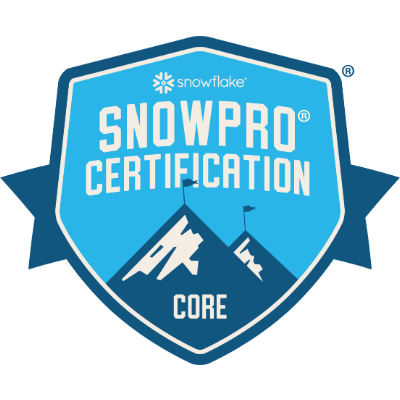</a> 
          <b>SnowPro Core</b> Issued Apr 2024, Expires Apr 2028
        </td>
    <td align="center" width="160">
          <a href="https://www.credly.com/badges/6a59e9bd-e6a7-4a36-bfe5-ac142e33b85d/linked_in_profile">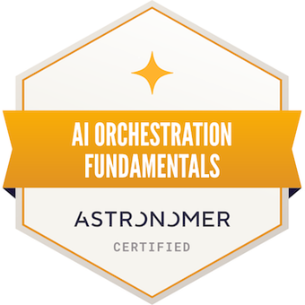</a> 
          <b>Astronomer AI Orchestration Fundamentals</b> Issued Aug 2026
        </td>
  </tr>
  <tr>
    <td align="center" width="160">
           
          <b>Power BI Data Analyst Associate</b> Issued Apr 2026, Expires Apr 2027
        </td>
    <td align="center" width="160">
           
          <b>Google Professional Data Engineer</b> Issued May 2025, Expires Jun 2027
        </td>
    <td align="center" width="160">
          <a href="https://www.credly.com/badges/fd9eb058-fd3c-42cb-be60-ff9166569a73/linked_in_profile">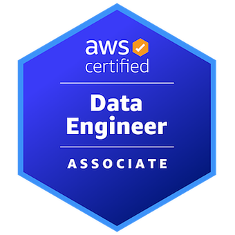</a> 
          <b>AWS Certified Data Engineer – Associate</b> Issued Dec 2024, Expires Dec 2027
        </td>
  </tr>
</table>

#### Databricks Academy Knowledge Badges

<table align="center">
  <tr>
    <td align="center" width="130">
           
          <b>Knowledge Badge - AI/BI for Data Analysts</b> 2026
        </td>
    <td align="center" width="130">
           
          <b>Knowledge Badge - SQL Analytics on Databricks</b> 2026
        </td>
    <td align="center" width="130">
           
          <b>Knowledge Badge - Introduction to Apache Spark</b> 2026
        </td>
  </tr>
</table>

### Streaming & Orchestration

<table align="center">
  <tr>
    <td align="center" width="160">
           
          <b>Data Streaming Engineer - Apache Flink</b> 2026
        </td>
    <td align="center" width="160">
           
          <b>Data Streaming Engineer Foundations</b> 2025
        </td>
    <td align="center" width="160">
          <a href="https://www.credly.com/badges/8f702a3f-3aec-4adb-a35e-bd0d1858d892/linked_in_profile">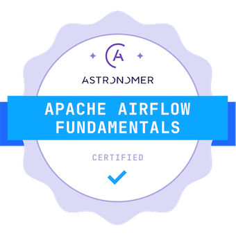</a> 
          <b>Astronomer Apache Airflow 3</b> Issued Oct 2025, Expires Oct 2027
        </td>
  </tr>
</table>

### Cloud, Databases & Platforms

<table align="center">
  <tr>
    <td align="center" width="160">
          <a href="https://catalog-education.oracle.com/pls/certview/sharebadge?id=F8746C3E557C8A8765DEBDAEA835D4DF980AA6A7CB800356307BB31EEE577331">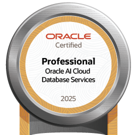</a> 
          <b>Oracle Cloud Database Services 2025 Certified Professional</b> Issued Aug 2025, Expires Sep 2027
        </td>
    <td align="center" width="160">
           
          <b>Airtable Admin Certification</b> Issued Jun 2025, Expires Jul 2027
        </td>
    <td align="center" width="160">
          <a href="https://verify.skilljar.com/c/7o2673krk52f">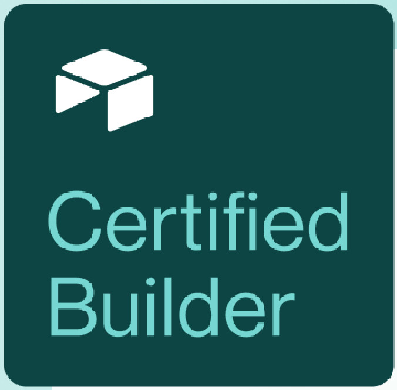</a> 
          <b>Airtable Builder Certification</b> Issued Jun 2025, Expires Jul 2027
        </td>
  </tr>
</table>

### 📚 Courses & Specializations

<table align="center">
  <tr>
    <td align="center" width="160">
          <a href="https://www.credly.com/badges/63ce30b5-a3ad-4ca2-8502-fa2574dade73/linked_in_profile">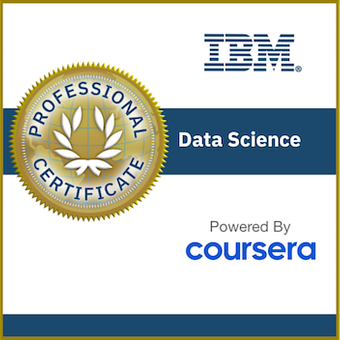</a> 
          <b>IBM Data Science Professional Certificate</b> Issued Aug 2023
        </td>
    <td align="center" width="160">
          <a href="https://www.credly.com/badges/d3e3942a-1320-4f23-8e21-1db2baaa402f/linked_in_profile">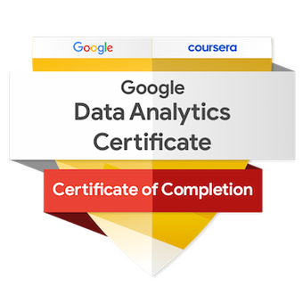</a> 
          <b>Google Data Analytics Professional Certificate</b> Issued Sep 2022
        </td>
  </tr>
</table>

<table align="center">
  <tr>
    <td align="center" width="220">
          <a href="https://www.coursera.org/account/accomplishments/specialization/certificate/DT2ZNFN49VWX">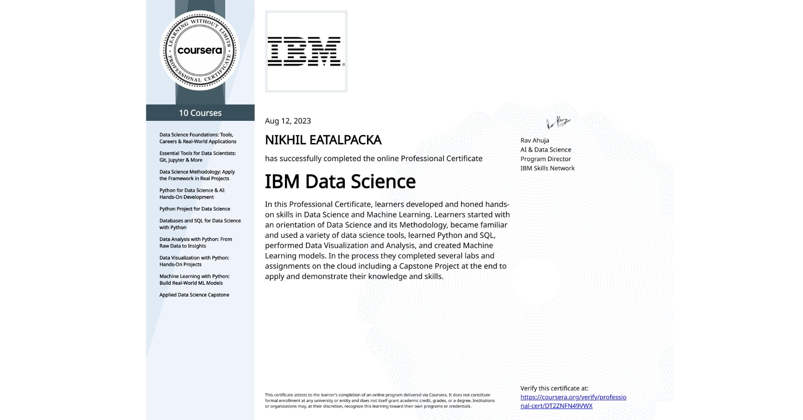</a> 
          <b>IBM Data Science Specialization</b> Issued Aug 2023
        </td>
    <td align="center" width="220">
          <a href="https://www.coursera.org/account/accomplishments/specialization/certificate/BG6P6R8CQ8DL">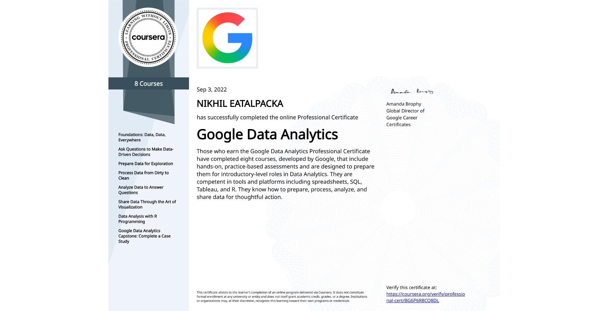</a> 
          <b>Google Data Analytics Specialization</b> Issued Aug 2022
        </td>
    <td align="center" width="220">
          <a href="https://www.coursera.org/account/accomplishments/specialization/YCMY6JYBESHM">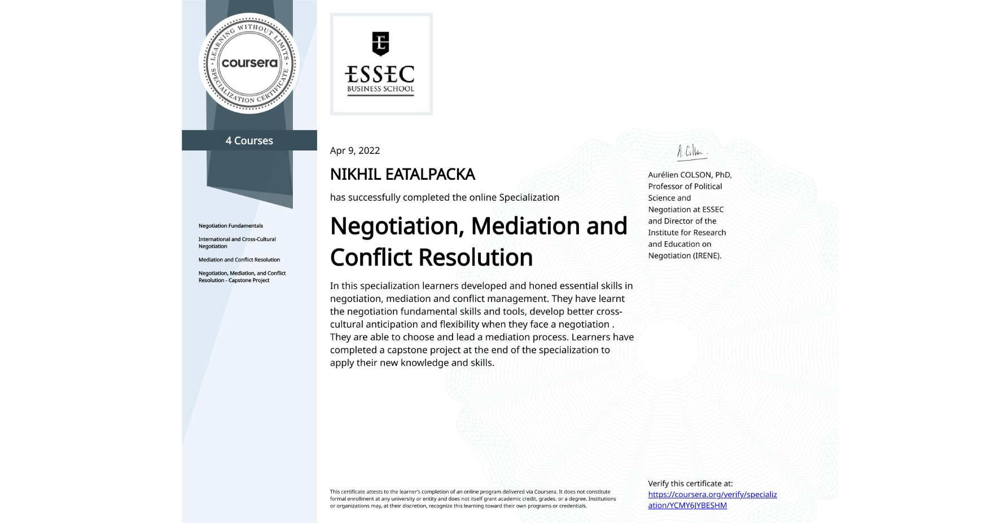</a> 
          <b>Negotiation, Mediation, and Conflict Resolution</b> Issued Apr 2022
        </td>
  </tr>
</table>

  
  
  

Previously held: <a href="https://learn.microsoft.com/api/credentials/share/en-us/NikhilEatalpacka-8669/37A20F1F25AD8FE0?sharingId=5C354DD1D169E5B8">Azure AI Engineer Associate</a> (expired Nov 2025) · <a href="https://learn.microsoft.com/api/credentials/share/en-us/NikhilEatalpacka-8669/3878BF56F89E6FC5?sharingId=5C354DD1D169E5B8">Azure Data Engineer Associate</a> (expired May 2025)

---

## <picture><source media="(prefers-color-scheme: dark)" srcset="assets/icons/milestone-dark.svg"></picture> Key Impact Snapshot

| Area | Result |
|--------|---------|
| AI Agents & RAG Systems | **5+** agents and RAG systems I built, now running in production |
| Enterprise Data Pipelines | **25+** pipelines running in production |
| Data at Scale | **10TB+** of data processed |
| Performance | **~40%** faster workflows |
| Cloud Cost Optimization | **~30%** cut from cloud spend |
| Platform Reliability | **99.9%** uptime in production |
| Business Impact | **15+** teams and business units relying on the data & AI |

---

## <picture><source media="(prefers-color-scheme: dark)" srcset="assets/icons/rocket-dark.svg"></picture> What I'm Building with AI

| Area | What it does |
|---|---|
| **[Agentic RAG & Context Engineering](https://github.com/itsnikhile/rag-mcp-pipeline)** | RAG systems that answer from real enterprise data, with citations. Built to hold up in production. |
| **[Multi-Agent Systems](https://github.com/itsnikhile/multi-mcp-data-swarm)** | LangGraph agents that work together — supervisor pattern, tool calling — and get work done end to end. |
| **[MCP Servers](https://github.com/itsnikhile/claude-mcp-data-engineer)** | Custom MCP servers that let Claude use enterprise data safely. One set of tools, shared across agents. |
| **[AI Evals & Observability](https://github.com/itsnikhile/rag-mcp-pipeline)** | Retrieval evals as a proper endpoint (precision@k, recall@k, MRR), so I can see when the system starts drifting. |
| **AI + Analytics** | Databricks AI/BI and Power BI for reporting people actually use. |

---

## <picture><source media="(prefers-color-scheme: dark)" srcset="assets/icons/cpu-dark.svg"></picture> AI & Machine Learning

  
  
  
  
  
  
  
  
  
  
  
  
  
  

---

## <picture><source media="(prefers-color-scheme: dark)" srcset="assets/icons/tools-dark.svg"></picture> Technical Toolkit

### 🗄️ Data Engineering & Big Data

  
  
  
  
  
  
  
  
  

### ☁️ Cloud Platforms

  
  
  
  
  

### 💻 Languages & Frameworks

  
  
  
  

### 📊 Analytics & Visualization

  
  
  
  

---

## <picture><source media="(prefers-color-scheme: dark)" srcset="assets/icons/graph-dark.svg"></picture> GitHub Stats
 
 

## <picture><source media="(prefers-color-scheme: dark)" srcset="assets/icons/pulse-dark.svg"></picture> GitHub Profile Summary
 

---

<picture>
  <source media="(prefers-color-scheme: dark)" srcset="https://raw.githubusercontent.com/itsnikhile/itsnikhile/output/github-snake-dark.svg" />
  <source media="(prefers-color-scheme: light)" srcset="https://raw.githubusercontent.com/itsnikhile/itsnikhile/output/github-snake.svg" />
  
</picture>

<!-- Footer -->

  

🤖 Building at the edge of AI + Data + Cloud. Always shipping. Always learning.
